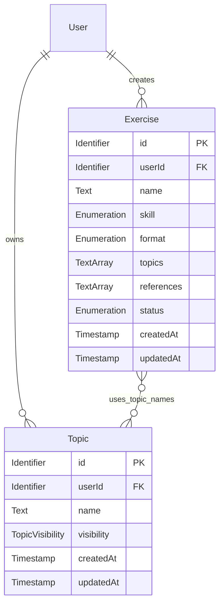

# Exercise Data Specification

## Introduction

The manage module implements user-facing features for creating and maintaining these Core-owned exercise and topic records.

This document defines the business meaning, required data, allowed values, and validation rules for the core module.

## Assumptions

1. Each exercise belongs to the authenticated user who created it.
2. Every exercise has at least one topic. Exercises retain topic names directly; topic records support topic discovery and selection.
3. Timestamps use UTC.
4. Authentication identity is managed outside the core module; the authenticated user's stable identifier is used for ownership.
5. Fields without the `Required` constraint are optional unless another constraint, such as `FormatFields`, requires them in a specific context; do not explicitly mark them `Optional`.

## Entity-Relationship Diagram

### Exercise

Represents reusable user-created English practice material across supported skills and content formats.

| Name            | ID               | Type                          | Constraints                | Default          | Description                                                                                   |
| --------------- | ---------------- | ----------------------------- | -------------------------- | ---------------- | --------------------------------------------------------------------------------------------- |
| Exercise ID     | `id`             | Identifier                    | Required, Unique           | —                | Stable identifier for the exercise.                                                           |
| Owner ID        | `userId`         | Identifier                    | Required                   | —                | Authenticated user who created the exercise.                                                  |
| Name            | `name`           | Text                          | Required, NonEmpty         | Derived          | Name shown to the exercise owner; derived at creation according to the Exercise Name Mapping. |
| Format          | `format`         | Exercise Format (Enumeration) | Required, ExerciseFormat   | —                | Defines the additional fields required for the exercise.                                      |
| Skill           | `skill`          | Skill (Enumeration)           | Required, ExerciseSkill    | Inferred         | English skill the exercise practices, inferred from its format.                               |
| Topics          | `topics`         | List of Text                  | Required, NonEmptyList     | —                | Topic labels used for grouping and filtering.                                                 |
| References      | `references`     | List of Text                  | NonEmptyList               | —                | Source links associated with the exercise.                                                    |
| Status          | `status`         | Exercise Status (Enumeration) | Required                   | `active`         | Whether the exercise is available to practice or archived.                                    |
| Creation Time   | `createdAt`      | Timestamp                     | Required                   | System generated | Time the exercise was created.                                                                |
| Update Time     | `updatedAt`      | Timestamp                     | Required                   | System generated | Time the exercise was last changed.                                                           |
| Scenario        | `scenario`       | Text                          | NonEmpty, FormatFields     | —                | Situational context for an exercise.                                                          |
| Prompts         | `prompts`        | List of Text                  | NonEmptyList, FormatFields | —                | Questions or counterpart utterances associated with an exercise.                              |
| Valid Responses | `validResponses` | List of Text                  | NonEmptyList, FormatFields | —                | Example responses that illustrate acceptable answers.                                         |
| Word            | `word`           | Text                          | NonEmpty, FormatFields     | —                | Vocabulary item being studied.                                                                |
| Meaning         | `meaning`        | Text                          | NonEmpty, FormatFields     | —                | Explanation of the vocabulary item.                                                           |
| Sentences       | `sentences`      | List of Text                  | NonEmptyList, FormatFields | —                | Example sentences for a vocabulary item.                                                      |
| Clues           | `clues`          | List of Text                  | NonEmptyList, FormatFields | —                | Clues that help a learner identify a vocabulary item.                                         |
| Sentence        | `sentence`       | Text                          | NonEmpty, FormatFields     | —                | Source sentence used for articulation practice.                                               |
| Paragraph       | `paragraph`      | Text                          | NonEmpty, FormatFields     | —                | Source paragraph used for articulation practice.                                              |
| Words           | `words`          | List of Text                  | NonEmptyList, FormatFields | —                | Words or phrases associated with an articulation exercise.                                    |

### Topic

Represents a label users can select to categorize and find exercises. Topics may be user-owned or shared.

| Name          | ID           | Type                           | Constraints                       | Default          | Description                                                   |
| ------------- | ------------ | ------------------------------ | --------------------------------- | ---------------- | ------------------------------------------------------------- |
| Topic ID      | `id`         | Identifier                     | Required, Unique                  | —                | Stable identifier for the topic record.                       |
| Owner ID      | `userId`     | Identifier                     | Required                          | —                | User who created and owns the topic.                          |
| Name          | `name`       | Text                           | Required, NonEmpty, UniquePerUser | —                | Label stored on the topic and referenced by exercises.        |
| Visibility    | `visibility` | Topic Visibility (Enumeration) | Required                          | `private`        | Whether the topic is private to its owner or shared publicly. |
| Creation Time | `createdAt`  | Timestamp                      | Required                          | System generated | Time the topic record was created.                            |
| Update Time   | `updatedAt`  | Timestamp                      | Required                          | System generated | Time the topic record was last changed.                       |

## Enumerations

### Topic Visibility

| Value     | Description                          |
| --------- | ------------------------------------ |
| `private` | Available only to the topic's owner. |
| `public`  | Available to all users.              |

### Skill

| Value           | Label         | Description                                     |
| --------------- | ------------- | ----------------------------------------------- |
| `communication` | Communication | Practice responding in real-life conversations. |
| `vocabulary`    | Vocabulary    | Practice recalling and using words in context.  |
| `articulation`  | Articulation  | Practice expressing or rephrasing thoughts.     |

### Exercise Format

| Value           | Label         | Description                                              |
| --------------- | ------------- | -------------------------------------------------------- |
| `communication` | Communication | Scenario-based conversation practice.                    |
| `word`          | Word          | Vocabulary practice centered on a target word or phrase. |
| `sentence`      | Sentence      | Sentence-level articulation practice.                    |
| `paragraph`     | Paragraph     | Paragraph-level articulation practice.                   |

### Exercise Status

| Value      | Label    | Description                                                 |
| ---------- | -------- | ----------------------------------------------------------- |
| `active`   | Active   | Available for practice.                                     |
| `archived` | Archived | Retained for the owner but unavailable in learner practice. |

## Constraints

| Rule ID        | Trigger                                           | Business Rule                                                                               | Violation                                                        |
| -------------- | ------------------------------------------------- | ------------------------------------------------------------------------------------------- | ---------------------------------------------------------------- |
| Required       | When a record is created or updated               | Field must be present in the object; it cannot be `undefined` or `null`.                    | Reject the record and identify the omitted field.                |
| Unique         | When assigning a record identifier                | An entity's identifier must identify only one record.                                       | Reject the record.                                               |
| NonEmpty       | When value is supplied                            | Value must contain a non-whitespace character after trimming.                               | Reject the value and identify the field.                         |
| NonEmptyList   | When value is supplied                            | After trimming and removing blank entries, list contains at least one non-empty text item.  | Reject non-text items or a list that is empty after cleanup.     |
| ExerciseFormat | When an exercise is created or its format changes | The selected format must be a supported Exercise Format.                                    | Reject the exercise and identify the invalid format.             |
| ExerciseSkill  | When an exercise is created or its format changes | Set `skill` from the selected `format` using the Format-Skill Mapping below.                | Reject the exercise if the format has no mapped skill.           |
| FormatFields   | When an exercise is created or its format changes | Required fields must be present; fields that do not apply to the format must be omitted.    | Reject the exercise and identify missing or inapplicable fields. |
| UniquePerUser  | When topics are created or renamed                | A topic name must not duplicate with other topics owned by the current user, ignoring case. | Skip topic creation; reject the topic rename.                    |

### Exercise Name Mapping

When an exercise is created, derive `name` from the trimmed value of its format's name source field. The create request does not accept a separate `name`.

| Exercise Format | Name Source Field |
| --------------- | ----------------- |
| `communication` | `scenario`        |
| `word`          | `word`            |
| `sentence`      | `scenario`        |
| `paragraph`     | `scenario`        |

### Format-Skill Mapping

| Exercise Format | Inferred Skill  |
| --------------- | --------------- |
| `communication` | `communication` |
| `word`          | `vocabulary`    |
| `sentence`      | `articulation`  |
| `paragraph`     | `articulation`  |

### Format-Specific Fields

Common fields (`name`, `format`, `skill`, `topics`, `references`, and `status`) apply to every format.

| Format          | Required fields                         | Optional format-specific fields |
| --------------- | --------------------------------------- | ------------------------------- |
| `communication` | `scenario`, `prompts`, `validResponses` | —                               |
| `word`          | `word`, `meaning`                       | `sentences`, `clues`            |
| `sentence`      | `sentence`, `scenario`                  | `words`                         |
| `paragraph`     | `paragraph`, `scenario`                 | `words`                         |

Optional array fields are omitted when absent or when trimming and removing blank entries leaves no values. Do not save empty arrays for optional fields. Required lists must contain at least one non-empty value after cleanup; otherwise, reject the record.

### Topic Name Cascade

Removing or renaming a topic affects the exercises that reference it:

| Operation | Topic visibility | Exercises affected                   |
| --------- | ---------------- | ------------------------------------ |
| Rename    | `private`        | Exercises owned by the topic's owner |
| Rename    | `public`         | All exercises                        |
| Delete    | `private`        | Exercises owned by the topic's owner |
| Delete    | `public`         | All exercises                        |

- A rename replaces matching names with the new name and removes duplicate names within each exercise.
- A delete removes matching names from the exercise topic list.
- If a delete leaves an exercise without topics, add `Uncategorized` to that exercise and ensure its owner has a `private` topic named `Uncategorized`.

## Revision History

| Version | Date       | Author       | Changes                                                                                             |
| ------- | ---------- | ------------ | --------------------------------------------------------------------------------------------------- |
| 1.9     | 2026-10-24 | Fluento team | Defined the Topic Name Cascade for renaming and deleting topics; applied UniquePerUser to renames.  |
| 1.8     | 2026-10-21 | Fluento team | Require an owner for every topic, including public topics.                                          |
| 1.7     | 2026-10-21 | Fluento team | Define case-insensitive topic name matching within the current user's visible topic scope.          |
| 1.6     | 2026-10-15 | Fluento team | Omit optional arrays from storage when absent or empty after cleanup.                               |
| 1.5     | 2026-10-15 | Fluento team | Made word-format sentences and clues, and sentence/paragraph-format words optional.                 |
| 1.4     | 2026-10-12 | Fluento team | Defined exercise name derivation by format.                                                         |
| 1.3     | 2026-10-12 | Fluento team | Made exercise skill depend on format; defined the Format-Skill Mapping.                             |
| 1.2     | 2026-10-07 | Fluento team | Clarified Core ownership of exercise content and related data; Manage provides management features. |
