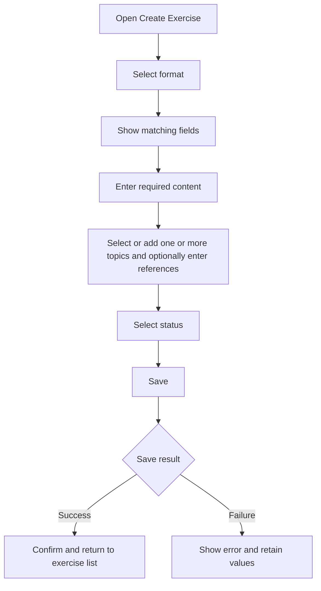

# Create Exercise

## Introduction

- **Description:** Create an exercise with all supported formats.
- **User Goal:** Add practice content with the fields its format requires.
- **Related Features:** View, update, and delete exercises.

## User Story

- As a user, I want to choose a format so I can enter the right practice content.

## Scope

### Inclusions

- Choose a supported format.
- Enter format-specific content.
- Add one or more topics and optionally add references.
- Choose from public topics and topics created by the authenticated user.
- Select a status.

### Exclusions

- Importing, updating, or deleting exercises.
- Creating or managing topics.
- Automatically generating exercise content.

## Dependencies

- Authenticated user account.
- Create Exercise API.
- Find Topics API for topic options.

## User Flow

## Acceptance Criteria

- Require a supported format.
- Infer the exercise name according to the [Exercise Name Mapping](../../core/spec/data.md#exercise-name-mapping).
- Infer skill from the selected format when saving.
- Show format-specific fields based on the selected format.
- Block saving if required values are missing or whitespace-only.
- Let the user select `active` or `archived`; default to `active`.
- Require at least one topic.
- Save the selected status and associate the exercise with the authenticated user.
- On success, confirm creation and return to the exercise list.
- On failure, show an actionable error, retain values, and allow retry.
- Support keyboard use, visible labels, and accessible validation and status messages.

## Form Requirements

### Common Fields

| Field      | Requirement                                                |
| ---------- | ---------------------------------------------------------- |
| Format     | Required; single select box containing supported format.   |
| Topics     | Required; use a multi-select that allows adding new ones.  |
| References | Source links; Optional; Textarea input, one link per line. |
| Status     | Required: single select box containing supported statuses. |

### Format-Specific Fields

- Show only fields available for the selected format; constraints follow the [core data specification](../../core/spec/data.md#format-specific-fields).
- Mark required fields according to the core data specification.
- Keep format-specific values only while that format remains selected; clear them when Format changes.

## Save and Error Handling

- On submit, remove empty or whitespace-only lines before validation; users need not remove them manually.
- Validate required lists after cleanup; each must retain at least one value.
- The API generates `name` according to the [Exercise Name Mapping](../../core/spec/data.md#exercise-name-mapping).
- The API infers and stores `skill` from `format` using the mapping in the core data specification.
- Include one or more selected topics (including new values). Omit references when none remain after blank lines are removed; do not save empty optional arrays.
- Prevent duplicate submissions while saving.
- For validation errors, identify fields and retain entered values.
- For API or network errors, show retry and retain values.
- If topics fail to load, explain the issue and allow manual topic entry; require at least one topic before creation.

## Related Documents

- [Core Exercise Data Specification](../../core/spec/data.md)
- [Find Topics API](../design/api/find-topics.md)
