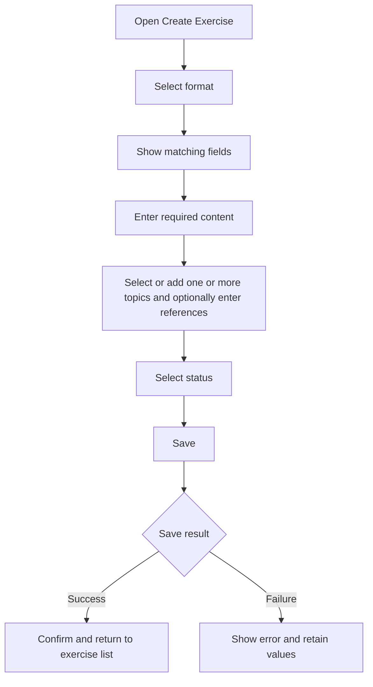

# Create Exercise

## Introduction

- **Description:** Create an exercise with all supported formats.
- **User Goal:** Add practice content with the fields its format requires.
- **Related Features:** View, update, and delete exercises.

## User Story

- As a user, I want to choose a format so I can enter the right practice content.

## Scope

### Inclusions

- Choose a supported format.
- Enter format-specific content.
- Add one or more topics and optionally add references.
- Choose from public topics and topics created by the authenticated user.
- Select a status.

### Exclusions

- Importing, updating, or deleting exercises.
- Automatically generating exercise content.

## Dependencies

- The user must be signed in to create an exercise.

## User Flow

## Acceptance Criteria

- Show format-specific fields based on the selected format.
- Let the user select `active` or `archived`; default to `active`.
- Let the user select an available topic or add a new topic name. Display newly added names in Title Case.
- Require at least one topic.
- Show the created exercise in the signed-in user's exercise list with the selected status.
- Make a newly added topic available to its owner for future exercises; a private topic belonging to another user remains unavailable.
- Support keyboard use, visible labels, and accessible validation and status messages.

## Save and Error Handling

- Let the user submit only when required fields are complete.
- Prevent duplicate submissions while saving.
- For validation errors, identify fields and retain entered values.
- For API or network errors, show retry and retain values.

## Related Documents

- [Core Exercise Data Specification](../../core/spec/data.md)
- [Find Topics API](../design/api/find-topics.md)
